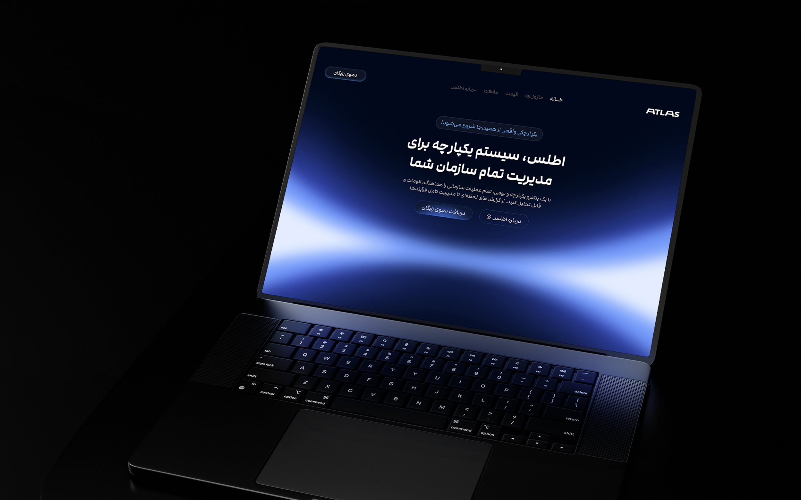
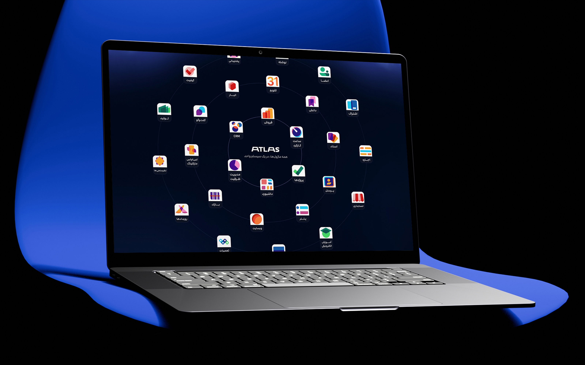
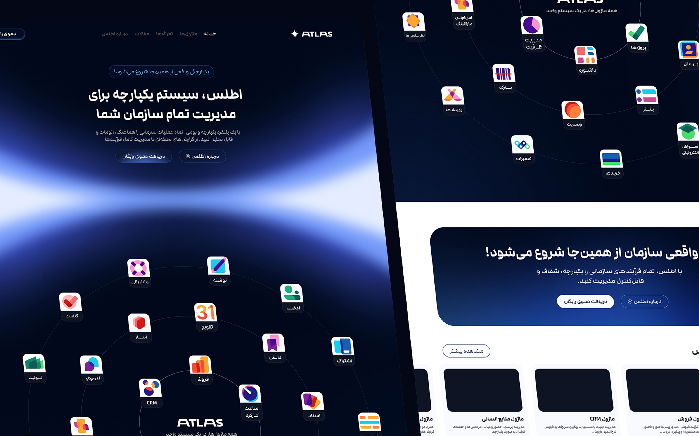
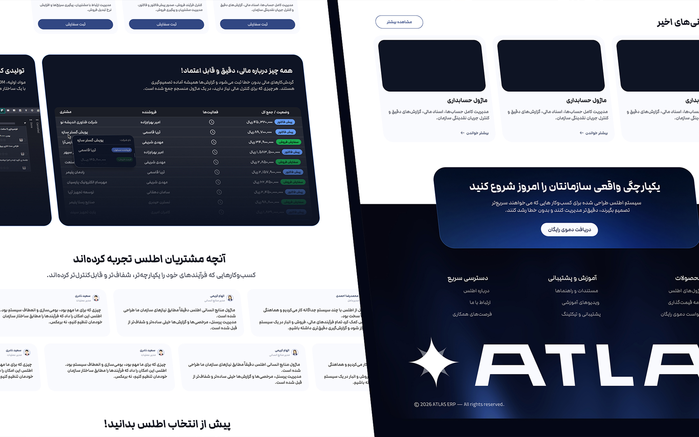

## The challenge

ERP platforms bring multiple business processes together, but communicating their value can quickly become overwhelming. With different modules, workflows and capabilities, it is easy for the experience to feel too technical or overloaded with information.

The challenge was to introduce Atlas as a modern, unified business management platform while moving away from the conventional, dashboard-heavy appearance of ERP websites. The design needed to balance product clarity with a distinctive, premium visual identity.

## Research

I explored how ERP platforms communicate their capabilities, with a focus on content structure, product presentation and visual hierarchy. Three priorities shaped the design direction:

- Present Atlas as one connected system rather than a collection of separate modules.
- Make complex business capabilities easier to understand through clear messaging and structured content.
- Create a modern, technology-driven visual identity that communicates scalability and future growth.

## Design process

I approached the landing page by building a clear narrative around Atlas and its value for businesses. The experience moves from a strong product introduction to its key capabilities, helping visitors understand how different parts of the platform work together.

Visually, I combined bold typography, futuristic elements, controlled spacing and a consistent color system to establish a premium, technology-focused aesthetic. Each section was designed to maintain clarity while reinforcing the idea of a connected, scalable platform.

## Final design

## Results

- Developed a complete landing page design that presents Atlas as a unified ERP platform with a clear product narrative and structured information hierarchy.
- Created a distinctive visual direction that brings a modern, premium and future-focused identity to a traditionally complex software category.

## More screens

