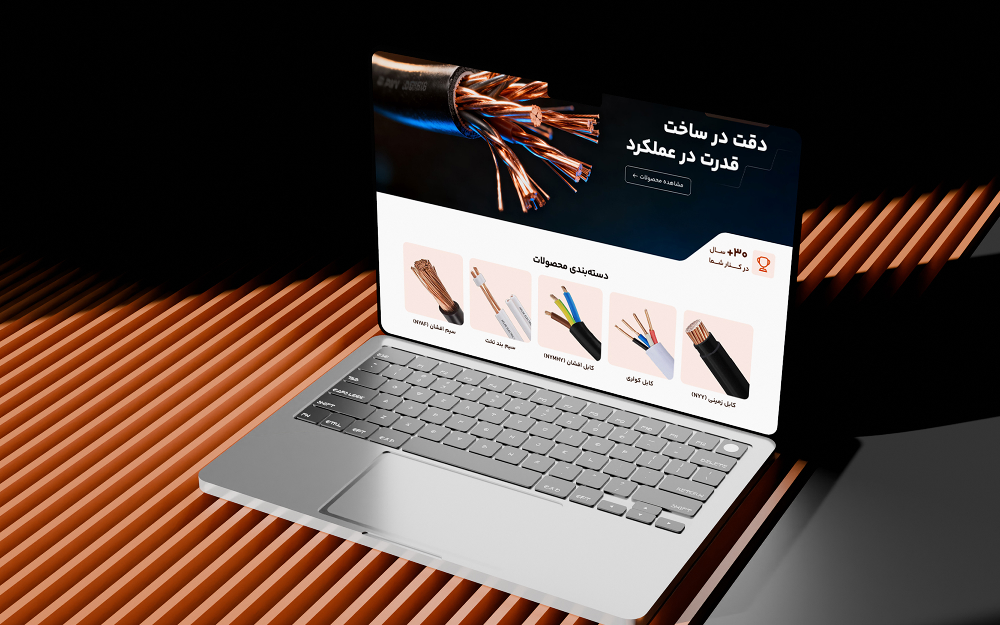
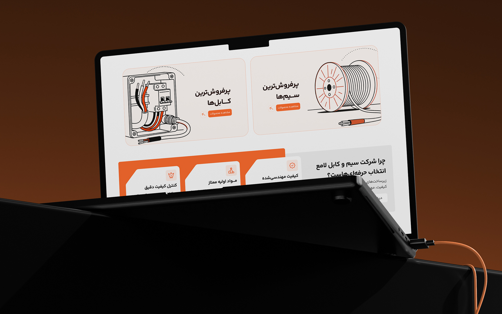
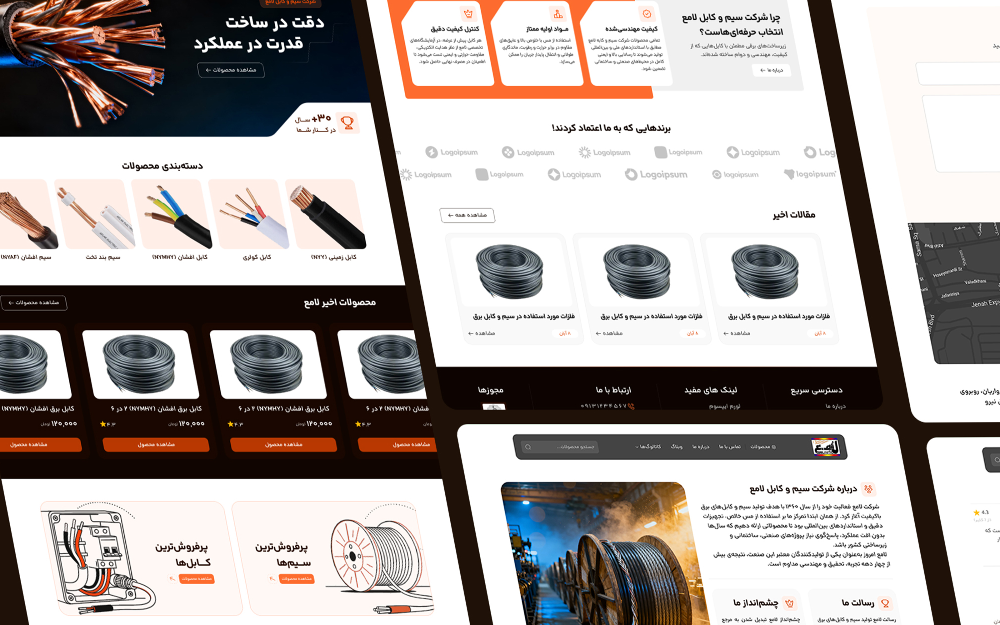
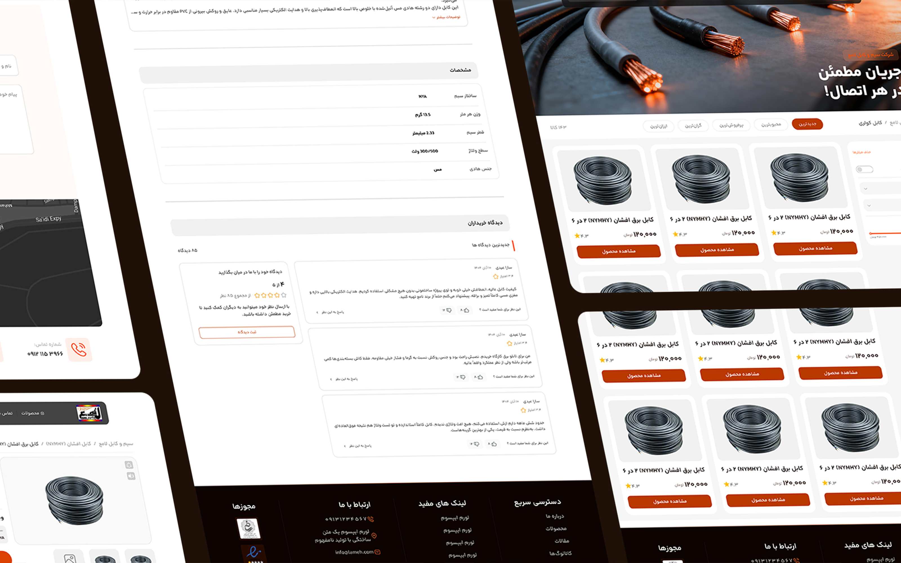
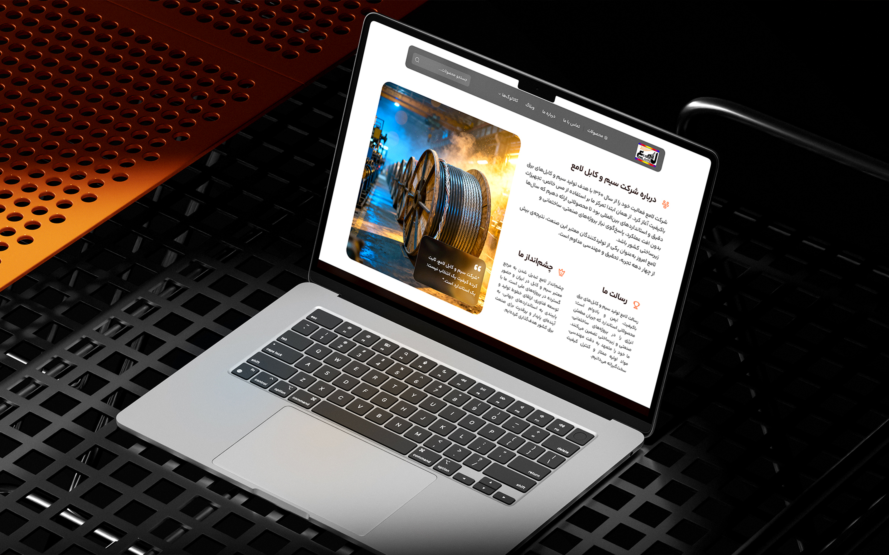

## The challenge

Lameh is an established manufacturer of electrical wires and cables, with a strong focus on product quality, safety and continuous development. However, its previous website no longer reflected the company's evolving identity or the standards behind its products.

The challenge was to transform an outdated website into a modern industrial e-commerce experience that communicates brand credibility while making it easier for customers to explore products, understand technical specifications and navigate the purchasing journey.

## Research

I reviewed the existing website and explored how industrial manufacturers organize product catalogs, communicate technical specifications and support product discovery. Three priorities shaped the redesign:

- Establish a stronger digital identity that reflects Lameh's engineering expertise, manufacturing quality and industry credibility.
- Improve product categorization and navigation so customers can find relevant wires and cables more efficiently.
- Present technical product information in a clear, structured format that supports product comparison and purchasing decisions.

## Design process

I started by rethinking the website's information hierarchy and product discovery experience. The goal was to create a clearer connection between the company's industrial identity, product categories and individual product details.

The interface was built around a minimal, modern visual direction, using strong typography, consistent spacing and structured layouts to communicate reliability and precision.

Particular attention was given to product navigation, category organization and the presentation of technical specifications, helping users move from exploring the catalog to evaluating individual products with less friction.

## Final design

## Results

- Redesigned Lameh's e-commerce website with a modern industrial visual identity that better reflects the company's engineering standards and product quality.
- Created a clearer product discovery experience through structured categories, improved navigation and more accessible technical information.

## More screens

