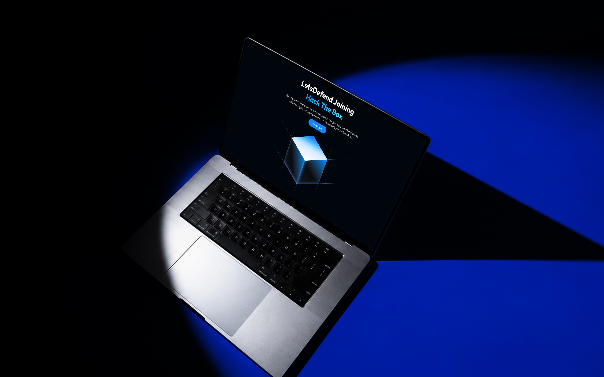
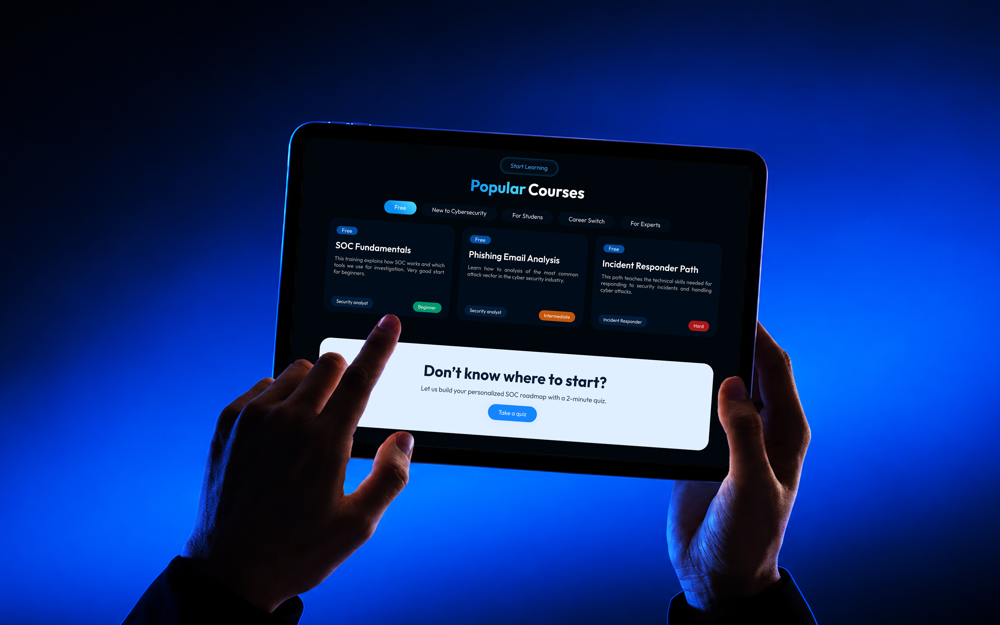
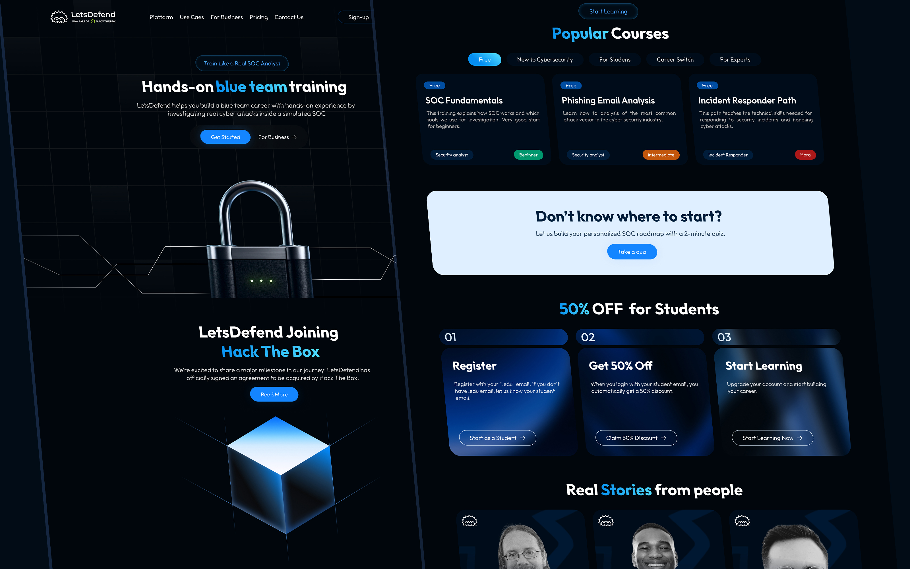
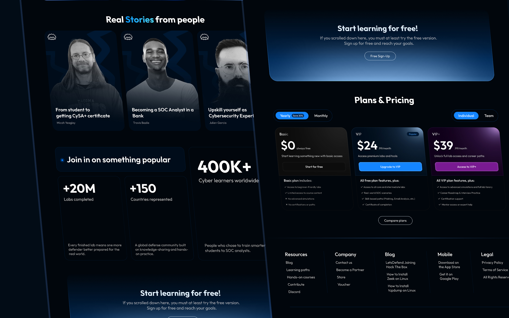
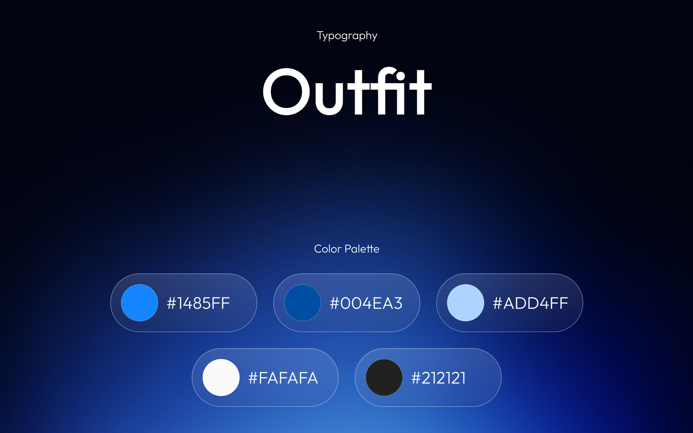

## The challenge

LetsDefend offers hands-on cybersecurity training through simulated Security Operations Center environments, where users can investigate cyberattacks and develop practical defensive skills.

The challenge was to rethink how the homepage introduces this experience to potential learners. The redesign needed to communicate the platform's practical value more clearly while creating a distinctive visual identity inspired by real cybersecurity environments.

The goal was to balance technical credibility with accessibility, making the platform appealing to both newcomers and experienced security professionals.

## Research

I reviewed the existing LetsDefend homepage, explored its learning experience and analyzed how cybersecurity training platforms communicate their capabilities and value. Three priorities shaped the redesign:

- Communicate the value of hands-on SOC training more clearly, helping visitors understand what they can learn and practice.
- Improve content hierarchy and CTA visibility to create a more straightforward path from product discovery to getting started.
- Develop a visual language inspired by cybersecurity tools and SOC environments while keeping the interface approachable and easy to navigate.

## Design process

I started by rethinking the homepage's content structure and messaging. The focus was on creating a clearer narrative that introduces LetsDefend, highlights its hands-on learning experience and guides visitors toward exploring the platform.

For the visual direction, I drew inspiration from real SOC dashboards, security monitoring interfaces and technical data visualizations. I combined these elements with bold typography, modern layouts and carefully controlled visual contrast to establish a stronger cybersecurity identity.

The redesigned sections were organized to balance visual engagement with readability, making complex technical concepts easier to explore while keeping the primary calls to action visible throughout the experience.

## Final design

## Results

- Created a concept homepage redesign with a clearer product narrative, stronger content hierarchy and more prominent calls to action.
- Developed a distinctive cybersecurity-inspired visual direction that communicates the platform's hands-on training experience while maintaining clarity and accessibility.

## More screens

