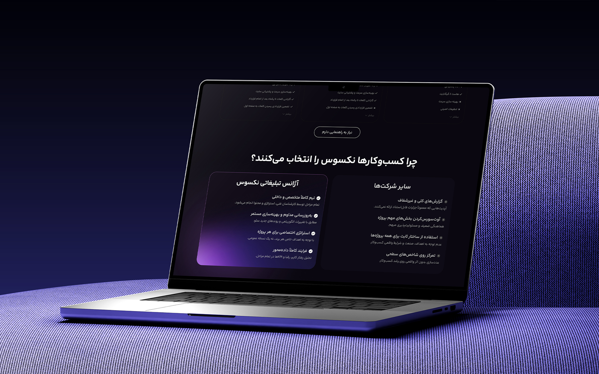
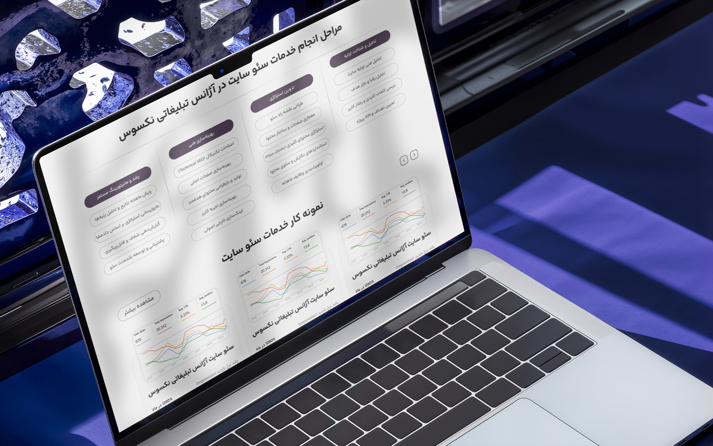
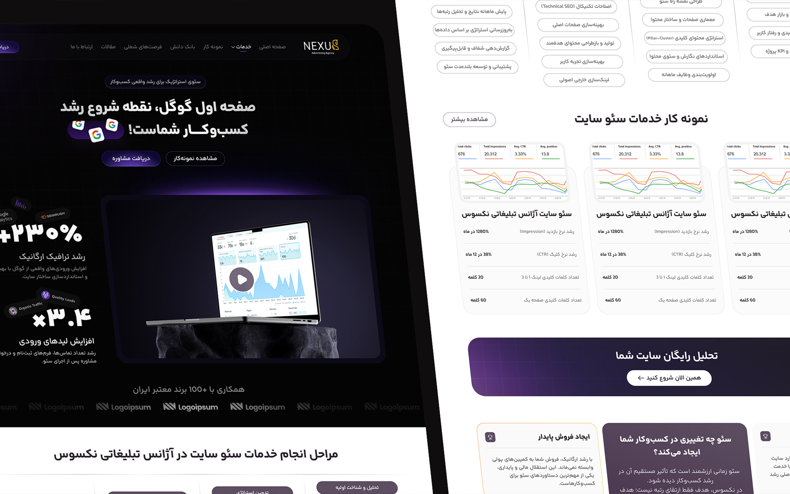
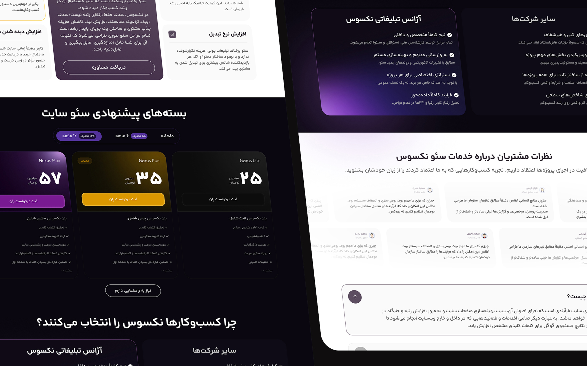
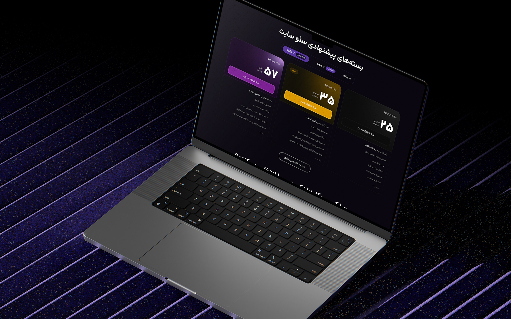

## The challenge

Advertising agencies offer a wide range of creative and marketing services, but presenting them all on a single landing page can easily overwhelm potential clients.

The challenge was to create a page that communicates Nexxus Agency's creative identity while making its services easy to understand and explore. The experience needed to balance expressive visual design with clear information hierarchy and a natural path toward contacting the agency.

## Research

I explored how creative and advertising agencies structure their service pages, communicate their expertise and guide potential clients toward taking action. Three priorities shaped the design direction:

- Establish a clear hierarchy that helps visitors quickly understand the agency's services and capabilities.
- Create a distinctive visual experience that reflects the agency's creative personality without sacrificing usability.
- Build a natural flow between service discovery, credibility and calls to action.

## Design process

I approached the landing page by organizing the content around the needs of potential clients. The structure was designed to introduce the agency's services clearly, communicate their value and encourage visitors to explore opportunities for collaboration.

For the visual direction, I focused on expressive typography, strong composition and a consistent design language to reflect the agency's creative character. Each section was designed to feel engaging while maintaining readability and a clear content hierarchy.

Special attention was given to the placement of calls to action, ensuring that visitors could easily move from exploring services to starting a conversation with the agency.

## Final design

## Results

- Designed a cohesive services landing page that brings the agency's creative identity and service offerings into one structured digital experience.
- Established a clear visual hierarchy and conversion-oriented layout that supports service exploration and encourages potential clients to get in touch.

## More screens

