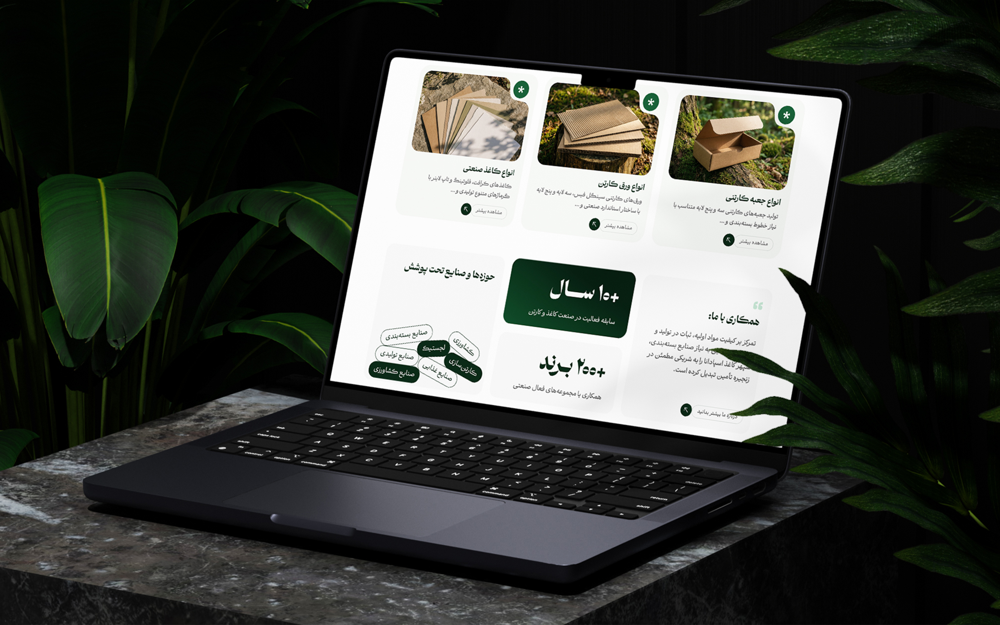
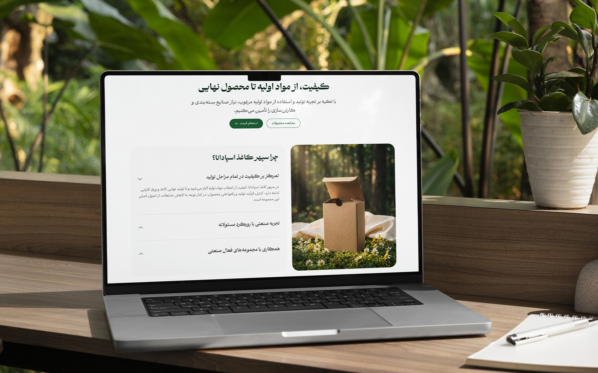
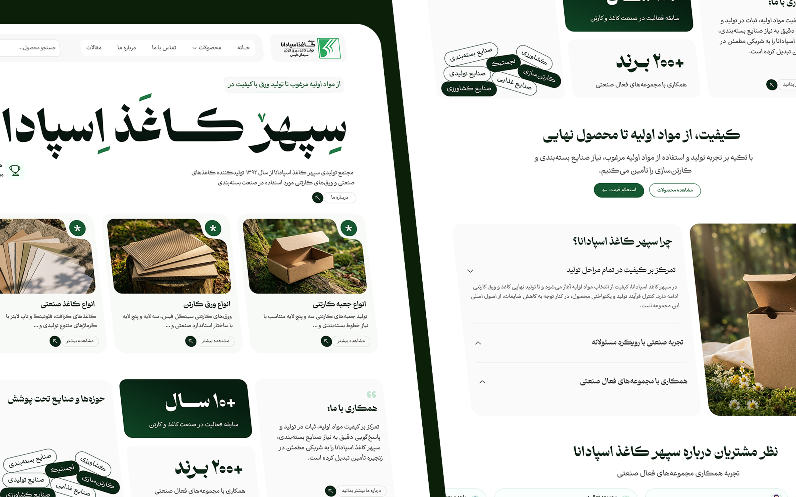
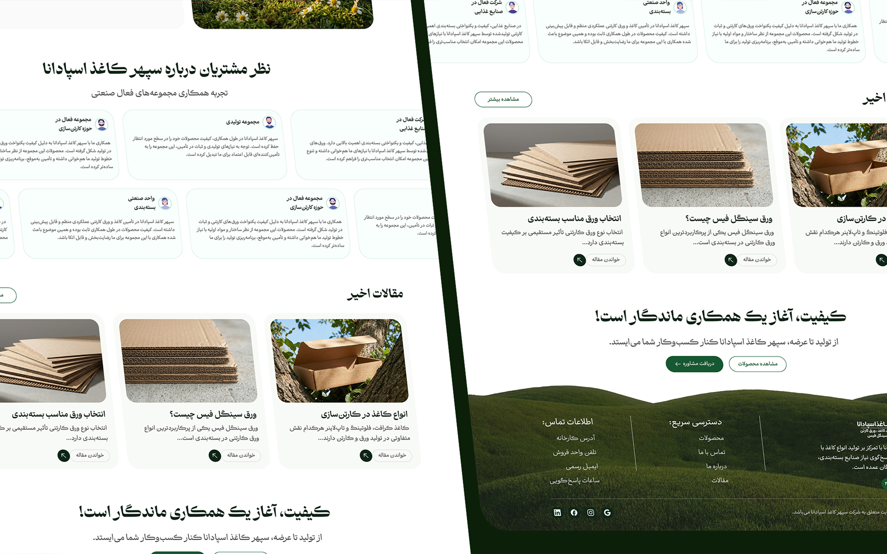

## The challenge

Sepehr Kaghaz Spadana is a manufacturer of industrial paper and cardboard sheets. The website needed to introduce the company and its product categories while communicating a modern identity and its emphasis on environmental responsibility.

The challenge was to move beyond the conventional look of industrial manufacturing websites and create an experience that felt professional, minimal and connected to nature without compromising product clarity.

## Research

I explored how industrial manufacturers present their products, communicate their brand identity and organize technical information across their websites. Three priorities shaped the design direction:

- Create a clear product hierarchy that helps visitors explore different categories without unnecessary complexity.
- Balance an industrial identity with natural elements to reflect the brand's environmental values.
- Develop a consistent visual language that makes industrial products feel more approachable and engaging.

## Design process

I started by defining a minimal information structure that gives the company and its product categories a clear place within the website. Typography, spacing and content hierarchy were carefully balanced to keep the experience simple and easy to navigate.

For the visual direction, I combined natural landscapes, organic textures and clean layouts to establish a connection between industrial production and the environment.

I also developed an AI-assisted visual workflow to create custom imagery with consistent lighting, composition and atmosphere. These visuals helped establish a cohesive identity across the website while supporting the brand's nature-inspired direction.

## Final design

## Results

- Designed a modern corporate website with a clear product structure and a consistent visual language that connects industrial manufacturing with nature.
- Developed a cohesive set of AI-generated visuals tailored to the website's design direction, creating a more distinctive and unified brand experience.

## More screens

